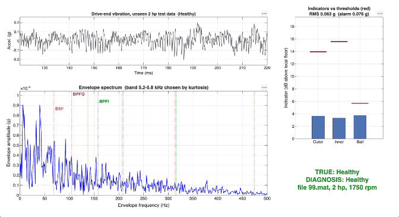
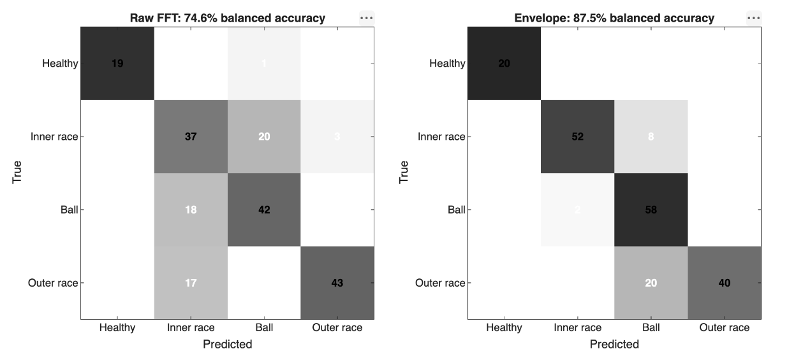
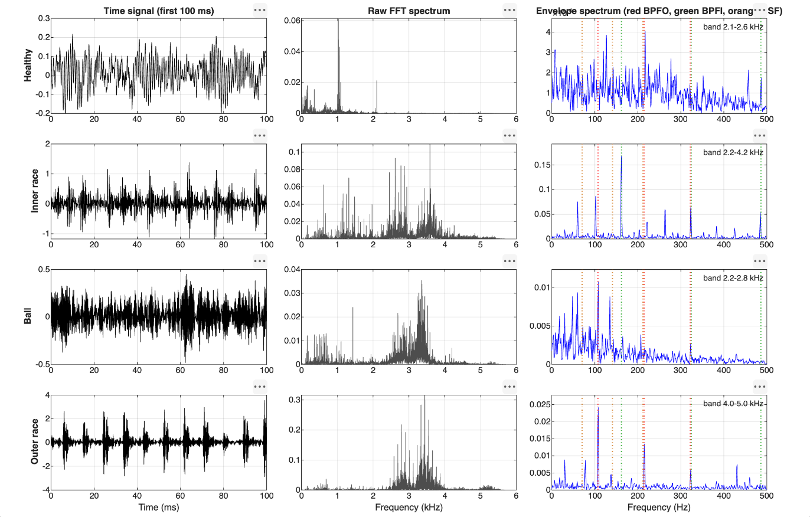

# Rotating Machinery Bearing Fault Detection (Envelope Analysis, Real Data)

MATLAB project that detects and classifies rolling-element bearing faults from vibration, using
**envelope analysis written from first principles** (no toolboxes) and **real laboratory data**
from the Case Western Reserve University (CWRU) Bearing Data Center.



## Key results (MATLAB Online, 22 Nov 2026)

Thresholds trained on motor loads 0–1 hp, **tested on unseen loads 2–3 hp** (200 one-second segments):

| Metric | Result |
|---|---|
| Healthy vs faulty detection | **100 %** (no false alarms, no missed faults) |
| Balanced accuracy, 4 classes (envelope) | **87.5 %** |
| Same rule on the raw FFT | 74.6 % |
| First version (global noise floor) | 53.3 % |
| With added noise, SNR 10 dB | 90.0 % |

Defect frequencies computed from the SKF 6205 geometry match the CWRU table
(BPFO 3.5848×, BPFI 5.4152×, CWRU's 4.7135× = 2 × BSF).



## Method
1. 1 s segments at 12 kHz, shaft speed from each file.
2. Spectral-kurtosis band selection (70 candidate bands) → Hilbert envelope by FFT → envelope spectrum.
3. **Local-prominence indicators**: each defect-frequency harmonic peak (±1 %) against the median of its own
   neighbourhood (±3–15 %), in dB. Ball uses 1, 2, 4 × BSF (3 × BSF sits on the 7th shaft harmonic).
4. **Two-stage rule** (plant practice): race fault if R_o or R_i exceeds its threshold; otherwise "faulty, no race
   signature" (ball) if R_b or overall RMS exceeds its threshold; otherwise healthy. 4 thresholds, learned by coordinate search.



## Honest limitations
* CWRU faults are machined (seeded), not naturally grown.
* The 0.014 in outer-race files have almost no BPFO signature (also reported by Smith & Randall, 2015); they are
  flagged as faulty but named "ball". Ball faults are found mainly through the RMS stage.
* Fault size is not reliably estimated from a single snapshot; trending is needed.

## Run
```matlab
cd matlab
RMF_Main        % downloads ~120 MB of CWRU data on first run, phases 1-6
RMF_Animation   % animated dashboard on unseen 2 hp data
RMF_PhoneTest   % phone accelerometer check (phyphox CSV), demo signal if no CSV
```
Base MATLAB R2021a+ only.

## Files
| File | Purpose |
|---|---|
| `RMF_Main.m` | Full pipeline, phases 1–6 |
| `RMF_Animation.m` | Animated diagnosis dashboard |
| `RMF_PhoneTest.m` | Field check for unbalance / misalignment with a phone |
| `RMF_Explore.m` | Design study (indicator / detector choice) |
| `envSpectrum.m`, `lpInd.m`, `classify2.m`, `train2.m`, `balAcc.m`, `bearingFreqs.m`, `loadCWRU.m` | Building blocks |
| `docs/RMF_Project_Report.pdf` | 21-page report with all screenshots |

## References
* CWRU Bearing Data Center, engineering.case.edu/bearingdatacenter
* W. A. Smith, R. B. Randall, MSSP 64–65 (2015) 100–131
* R. B. Randall, J. Antoni, MSSP 25 (2011) 485–520

Author: Hameed Hussain · MIT License
